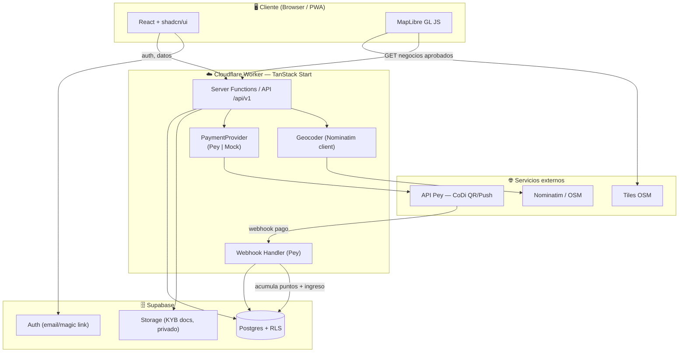
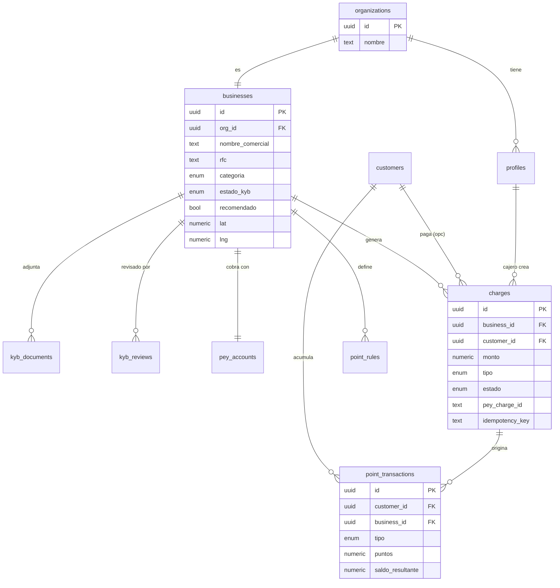
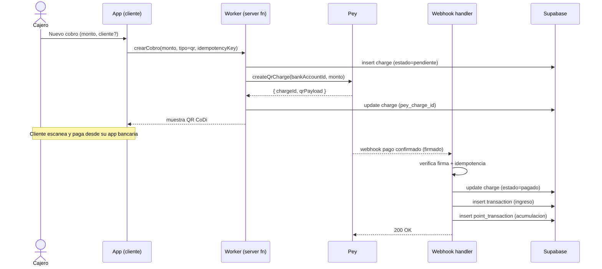
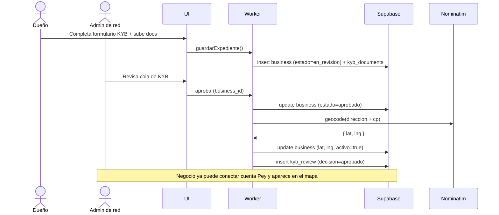
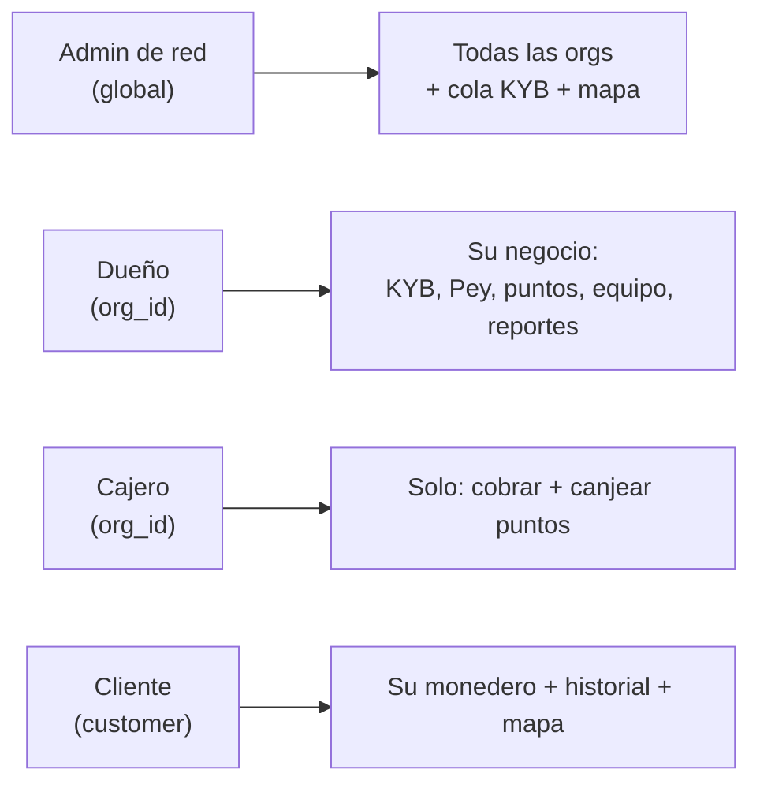

# Arquitectura de Backend — Handle

Versión 0.1 · 2026-11-07

Diagramas en Mermaid (se renderizan en GitHub, VS Code con extensión Mermaid, y la mayoría de visores Markdown).

---

## 1. Diagrama de componentes (alto nivel)

---

## 2. Diagrama entidad-relación (núcleo)

---

## 3. Secuencia — Cobro CoDi con acumulación de puntos

---

## 4. Secuencia — KYB (alta y aprobación)

---

## 5. Roles y acceso (RLS resumen)

